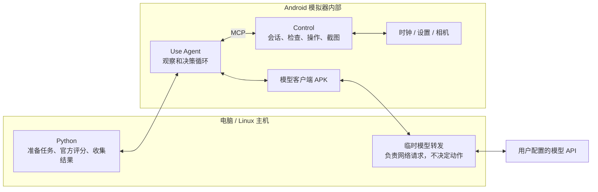

# AndroidWorld On-device Agent

让 **Computer Use Agent 和 Computer Control 运行在 Android 内**，通过外部模型 API 决定操作，再用 AndroidWorld 官方任务检查是否完成。

这个仓库按正常源码目录维护，提供运行所需的源码、构建与部署入口、配置示例和结果报告工具。第一次使用需要安装依赖、准备专用安卓模拟器并填写自己的模型配置；之后可以用一条命令顺序运行四项任务。

源码和文档可以直接在 GitHub 上阅读、修改并比较版本。下载内容是源码，需要按下面的步骤配置和构建；旧版上传的源码压缩包保留在 Git 提交历史中。

## 能做什么

| 任务 | 实际操作 |
|---|---|
| `ClockStopWatchRunning` | 打开时钟并启动秒表 |
| `ClockTimerEntry` | 输入指定时长的计时器，不启动 |
| `SystemBrightnessMax` | 把屏幕亮度调到最大 |
| `CameraTakePhoto` | 用相机拍一张照片 |

每项任务保存官方得分、最终截图、执行日志、任务总耗时，以及模型调用、Control 操作、截图观察和程序处理的用时。

**当前范围：**专用 Android 13 / API 33 模拟器、主屏 display 0、上表四项任务。当前入口没有接入逐任务电脑真人授权，也没有接入 MobiClaw 系统服务。真机、任意 App 和第二套虚拟界面不属于本版本已验收的能力。

## 程序怎么工作



**Use 决定下一步做什么，Control 检查并执行，MCP 是两者的通信协议。** 模型推理在外部，任务循环在 Android 内。默认由主机转发模型请求，以兼容 AndroidWorld 固定的设备时间；该转发器不负责规划或选择动作。完整分层、审核位置和 MobiClaw 接口见 [结构说明](docs/ARCHITECTURE.md)。

## 第一次运行

推荐在 Linux 或 WSL 的同一个环境中运行 Python、ADB 和模拟器。需要 Python 3.11、JDK 17、Android SDK 和支持截图输入的 Responses API 模型。Android SDK 组件与完整操作步骤见 [安装说明](docs/SETUP.md)。

克隆仓库并进入项目目录：

```bash
git clone https://github.com/wangleo743-ops/androidworld-ondevice-agent.git
cd androidworld-ondevice-agent
python3 run.py init
```

也可以在仓库首页选择 **Code → Download ZIP**，解压后进入包含 `run.py` 的文件夹，再执行 `python3 run.py init`。

先编辑生成的 `config.local.json`，填好 SDK / JDK 路径、模型名和接口地址，保存后继续：

```bash
# 安装 Python 依赖并取得固定版本的 AndroidWorld
python3 run.py setup --python python3.11

# 本机编译 Android Agent 和模型客户端
python3 run.py build

# 已按安装说明准备 SDK 镜像后，创建并启动专用模拟器
python3 run.py emulator create
python3 run.py emulator start
```

保持模拟器运行，在同一环境的另一个终端、同一仓库目录执行：

```bash
# 初始化四项任务所需的应用，然后安装本项目的 Android 程序
python3 run.py prepare --dedicated-emulator
python3 run.py deploy --dedicated-emulator
python3 run.py doctor

# 先看计划；这条命令不运行模型
python3 run.py plan

# 顺序执行四项任务；提示后隐藏输入一次 API Key
python3 run.py run --dedicated-emulator
```

只跑秒表任务：

```bash
python3 run.py run --dedicated-emulator --tasks ClockStopWatchRunning
```

`--dedicated-emulator` 表示你选择的是专用实验模拟器。官方任务会重置时钟等测试数据，拍照任务会清理该模拟器的照片和视频目录；不要把这个入口用于日常手机或混有个人数据的模拟器。

## 配置模型

编辑 `config.local.json`：

```json
{
  "model_transport": "host_relay",
  "responses_endpoint": "https://api.openai.com/v1/responses",
  "model": "YOUR_MODEL_NAME",
  "effort": "default",
  "allow_http": false
}
```

这里只展示模型相关字段，保留生成文件中的设备和构建字段。`model` 必须换成你的服务实际支持的模型名；`responses_endpoint` 是完整的 Responses 请求地址。`effort: "default"` 不额外发送推理强度参数。默认保留 `host_relay`，由主机使用正确时间验证模型服务的 HTTPS 证书。

API Key 在运行时隐藏输入，不放入上述文件。默认转发模式中，真实密钥只保留在主机内存，Android 模型客户端使用本次任务的临时令牌。首次建立自己的测试签名后，保留本机签名文件供后续构建使用，避免 Planner APK 更新时签名不一致；该文件不提交到 Git。

## 看结果

每轮结果保存在 `androidworld-integration/batches/` 的独立批次目录。先看 `summary.json`，再打开各任务的最终截图和计时记录。

```bash
python3 run.py report "androidworld-integration/batches/替换为本次批次/summary.json"
```

把示例中的“替换为本次批次”改成终端打印的实际批次目录名。报告会列出每项任务是否成功、完整流程与 Android 内部耗时、每一步的时间和截图链接。时间如何相加、历史四项实验结果及失败尝试说明见 [结果与时间口径](docs/RESULTS.md)。

历史研究版本完成过四项任务，官方原始分均为 1；它们来自两批运行。本次便携化整理版尚未完成新的在线四任务复验，历史结果不作为新构建的成绩。

不连接模型和模拟器的本地检查：

```bash
python3 scripts/check.py
python3 scripts/check_distribution.py
```

Java 检查及具体前提见 [安装说明](docs/SETUP.md#本地验证与发布检查)。本次检查、构建结果及尚未验证的内容见 [验证记录](docs/VALIDATION.md)。

## 主要文件

| 路径 | 作用 |
|---|---|
| `run.py` | 统一命令入口 |
| `mobile-ondevice-agent/src/` | Android 内 Agent、Control、MCP、会话与预留接口 |
| `mobile-ondevice-agent/androidworld-planner-app/` | 独立模型客户端 APK 源码 |
| `androidworld-integration/` | 任务目录、官方评测适配、构建和报告程序 |
| `docs/` | 安装、架构和结果解释 |

仓库不包含 API Key、模型账号、个人路径配置、签名私钥、SDK 镜像或原始实验记录。第三方来源和原创代码的许可状态见 [许可说明](THIRD_PARTY_NOTICES.md)。

## 日常维护

直接修改对应目录中的源码或文档，并通过 Git 提交更改。提交前运行上面的本地检查，用 `git diff` 核对改动；个人配置、运行结果和构建产物由 `.gitignore` 排除。`.github/workflows/check.yml` 会在推送和 Pull Request 时执行源码检查、离线测试及 Android 构建，不调用真实模型或操作模拟器。

需要另行分发源码压缩包时运行 `python3 scripts/package.py`，产物位于 `dist/`；文件校验清单 `SOURCE_MANIFEST.json` 在打包时生成，不作为日常维护文件提交。
