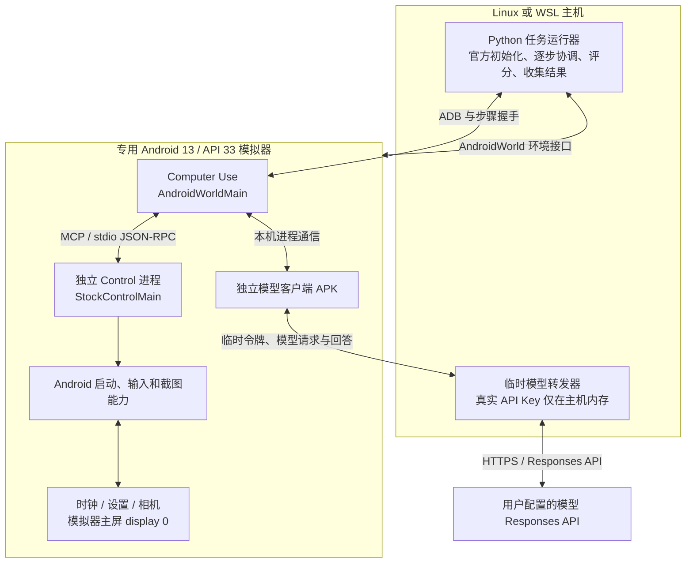
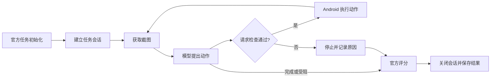

# 程序结构与执行流程

本项目让 Agent 的任务循环运行在 Android 内。外部模型负责根据截图提出下一步动作，Control 负责管理会话、检查请求并调用 Android 执行。电脑上的 Python 程序负责 AndroidWorld 的任务准备、官方评分和结果收集。

默认模型链路经过本次任务的主机转发器。它转发模型请求与回答，不分析截图、不生成动作，也不承接 Agent 的任务循环。

## 三个名字分别是什么意思

| 名称 | 职责 | 主要文件 |
|---|---|---|
| Computer Use | 观察画面、调用模型、选择动作、管理任务进度 | `benchmark/AndroidWorldMain.java` |
| Computer Control | 建立会话、限定操作目标、检查并执行动作、返回截图 | `standard/StockControlMain.java`、`benchmark/AndroidWorldControl.java` |
| MCP | Use 与 Control 之间的工具调用协议 | `standard/StockMcpConnection.java`、`service/GuiMcpService.java` |

以上 Java 文件都在 `mobile-ondevice-agent/src/com/lab/mobileagent/` 下。

## 程序在哪里运行

Agent 和 Control 是不同的 Android 进程，但当前都使用 shell UID 2000。这个划分便于独立管理生命周期和记录开销，不代表已经具备不同系统身份之间的安全隔离。模型客户端是独立 APK；默认转发模式中，真实 API Key 只在主机内存中使用，APK 收到的是本次任务临时令牌，二者均不写入配置文件。

AndroidWorld 初始化会把设备时间设为 2023 年。直接从该设备请求当前的 HTTPS 服务，可能因为证书尚未生效而失败。默认 `host_relay` 使用主机当前时间完成正常的 HTTPS 校验，模拟器通过宿主机地址和临时端口连接转发器；程序不为此修改官方设备时间或关闭证书验证。`direct` 模式保留给经过单独验证的直连场景。

主机在每一步之间进行协调，也负责官方评分。因此，Agent 的 Android 运行时间包含等待主机的时间；不能把整个过程都当作模型推理时间。

## 一项任务如何完成

1. **预检。** 检查指定模拟器、API 版本、上游代码版本、目标 App 和部署产物。
2. **官方初始化。** AndroidWorld 按任务规则设置初始状态。计时器任务会先准备时钟，相机任务会清理专用模拟器的照片目录。
3. **创建 Agent 和会话。** Android 内启动 Agent，Agent 启动独立 Control。Control 将任务、调用者、目标 App 和 display 0 绑定到会话。
4. **获取观察。** Control 查询当前前台目标，读取截图，再核对观察仍属于允许的目标。
5. **调用模型。** Agent 把任务和画面发给模型客户端。默认模式下，客户端通过临时转发器调用用户配置的 Responses API；转发器不选择或修改 Agent 动作。
6. **检查并执行。** Agent 检查返回格式；Control 在入队和执行前检查会话与动作范围，底层适配器再次检查前台目标，再执行操作。
7. **继续或结束。** 返回新观察，重复上述步骤。模型可以声明完成或受阻；任务也可能因预算、超时或错误结束。
8. **官方评分。** 主机调用 AndroidWorld 的 `is_successful` 检查 App 或系统实际状态。
9. **关闭并收集。** 确认 Control 清理和进程退出后，保存截图、日志与计时，再执行官方任务清理。

动作返回成功只表示控制请求执行完成；是否完成业务任务，以独立官方评分为准。

## 当前检查的范围

当前发布入口是 `stock_android_mcp_baseline_v1`，覆盖四项固定任务。模型不能选择任意 App、屏幕编号、可执行文件或运行配置。

Control 检查会话是否仍有效、动作及参数是否合法、前台 App 是否在允许范围内，并记录执行和观察事件。它不会把模型的“在授权范围内”自评转换成用户许可。

这条入口没有接入原天气实验的电脑逐任务确认、手机用户授权数据库或 MobiClaw 系统授权服务。`formal_user_grants=false` 是本基线的实际状态。提示约束与程序检查不能当作正式系统用户授权的验证结果。

## MobiClaw 接口预留

`platform/MobiClawPorts.java` 定义未来系统后端需要提供的能力：

| 接口 | 接入后的职责 | 当前发布状态 |
|---|---|---|
| `Sessions` | 由系统建立和维护任务与 UI 的绑定 | 接口预留；baseline 使用自己的会话管理 |
| `OperationResolver`、`Authorization` | 解析操作目标，匹配用户许可，检查过期和撤销 | 接入流程有离线检查；未接系统授权库 |
| `Resources`、`Commands` | 资源排队、执行前校验、输入投递 | 接入流程有离线检查；未接系统资源管理器 |
| `Rendering` | 像素、DisplayList、界面刷新回执 | baseline 使用像素截图；增强能力预留 |
| `UiStateExport`、`Recovery` | 保存状态、重建界面、核验并安全重放 | 接口预留 |
| `SecondUi` | 协调用户和 Agent 的第二套界面及共享业务状态 | 接口预留 |

`AuthorizedDispatch.java` 描述“解析目标 → 匹配授权 → 入队 → 执行前复查 → 执行 → 释放资源”的调用约定。它没有接入当前 stock baseline，也不能证明 MobiClaw 系统后端已实现。

## 与原真机天气工程的关系

目录名 `mobile-ondevice-agent` 沿用原工程命名，本发布包已提取 AndroidWorld 需要的运行类、公共组件和 MobiClaw 接口。原真机天气的启动程序、电脑确认授权流程和设备私有配置没有作为可运行入口打包。

因此，下载本仓库得到的是 AndroidWorld 基线的完整运行链；它不包含一套已经适配任意真机、任意 App 的工具。README 中的步骤只覆盖专用 API 33 模拟器与四项任务。
